# 云桌面宿主机接收端设计目录

阶段 2 系统设计，2026-10-18。需求问题已解决；本阶段采用独立本地浏览器接收应用，支持实时抓屏和录像导入，复用现有 WASM 与原发送端/协议。接收应用运行在云桌面客户端所在的宿主机。

核心边界：一次一个文件；全新解码实例隔离会话；停止清理并防止旧消息串入；完整产物与保存尝试分离，保存失败可重试；先本地同机全功能模拟，再由用户真实云桌面验收。浏览器选择是本阶段设计决定，不将 EXE 安装包或多套兜底加入范围。

当前源码和文档检查不等于产品验证：WASM 装配、本地全功能模拟、真实云桌面、性能容量均 NOT RUN。版本/规模/性能按用户批准策略先测再确认。

## 阅读导航

| 文档 | 内容 |
|---|---|
| [需求与热点](requirements.md) | 目标、用户约束、FR/NFR/AC 与 H-CAP/H-VIDEO/H-MEM/H-ASSET/H-PERF/H-SAVE |
| [架构与决策](architecture.md) | 模块边界、双输入、状态隔离、内存/保存、独立装配、14 AC 验证落点 |
| [证据索引](sources.md) | 当前源码、Context7 / MDN 文档、未验证边界 |
| [设计 Todo](todo.md) | 五阶段进度与 QA |
| [设计 QA](qa.md) | 11 图语法、嵌入、链接、AC 追踪及未运行项目 |
| [模块契约与错误矩阵](module-contract-error-matrix.md) | 阶段 2.5：8 个模块、10 个接口、53 项码及严格解压适配门槛 |
| [机器可读契约](contracts/README.md) | 元数据 schema、73 个合成样例、初始安全配置、错误登记与契约 QA |
| [契约检查](contracts-qa.md) | schema、33 个结构负向样例、53 项码、10 接口和 14 AC 的检查证据 |
| [交付路线图](../plans/roadmap.md) | 阶段3：5 Epic、10 Story、24 Task及本地先于现场的验收与交付计划 |
| [已确认需求](../requirements/requirements-spec.md) | 6 FR、8 NFR、14 AC、4 个后测验证项 |
| [流水线状态](../dev-pipeline/pipeline-state.json) | 阶段 2 与后续阶段确认门 |

下方全文嵌入全部 11 张 Mermaid 图，同时保留独立源文件。ERD 为概念对象关系，不表示新增数据库。

## 全局事件时间线

[Mermaid 源文件](big-picture.mmd)

```mermaid
flowchart LR
  classDef event fill:#ff9800,stroke:#e65100,color:#000
  classDef command fill:#2196f3,stroke:#0d47a1,color:#fff
  classDef actor fill:#ffeb3b,stroke:#f57f17,color:#000
  classDef system fill:#9c27b0,stroke:#4a148c,color:#fff
  classDef aggregate fill:#4caf50,stroke:#1b5e20,color:#fff
  classDef policy fill:#00bcd4,stroke:#006064,color:#fff
  classDef hotspot fill:#f44336,stroke:#b71c1c,color:#fff
  Sender["发送操作者"]:::actor --> Send["运行原项目发送端"]:::command
  Send --> Displayed["cimbar 动画已显示"]:::event
  Displayed --> Source["云桌面客户端窗口或已录录像"]:::system
  User["宿主机接收操作者"]:::actor --> Start["开始实时抓屏或导入录像"]:::command
  Start --> Session["单文件接收会话"]:::aggregate
  Source --> Selected["输入源已选定"]:::event
  Session --> Selected
  Selected --> Frames["画面帧已获取"]:::event
  Frames --> Decode["使用原 WASM 解码与重建"]:::policy
  Decode --> Ready["完整文件已重建"]:::event
  Ready --> Artifact["会话内不可变文件产物"]:::aggregate
  Artifact --> Save["点击保存文件"]:::command
  Save --> Saved["写入已关闭并完成"]:::event
  Saved --> Check["外部核对 SHA-256"]:::command
  Check --> Matched["原文与接收文件一致已验证"]:::event
  Validator["实施执行方随后交付用户现场验收"]:::actor --> Check
  Selected -.-> H1["? H-CAP / H-VIDEO 实际画面与格式"]:::hotspot
  Decode -.-> H2["? H-ASSET / H-MEM / H-PERF 装配与测量"]:::hotspot
  Save -.-> H3["? H-SAVE 保存能力与权限"]:::hotspot
```

## 关键流程：实时抓屏

[Mermaid 源文件](processes/process-live.mmd)

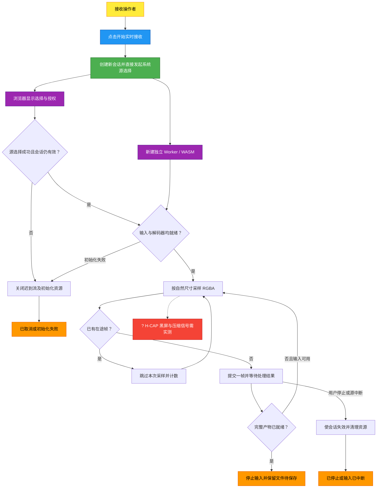

## 关键流程：录像与 EOF

[Mermaid 源文件](processes/process-video.mmd)

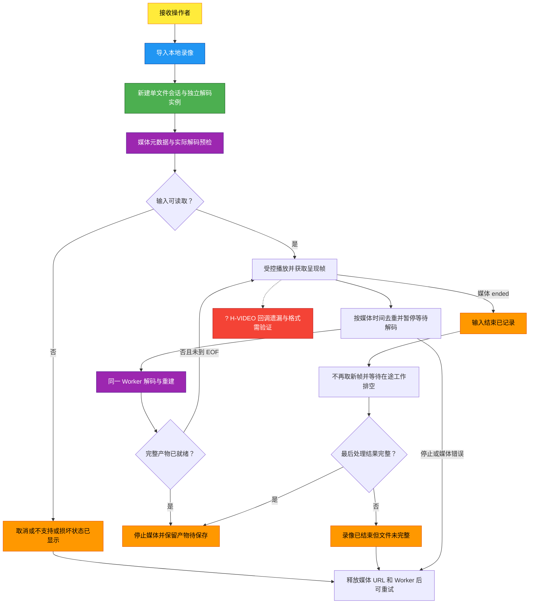

## 关键流程：保存与哈希

[Mermaid 源文件](processes/process-save.mmd)

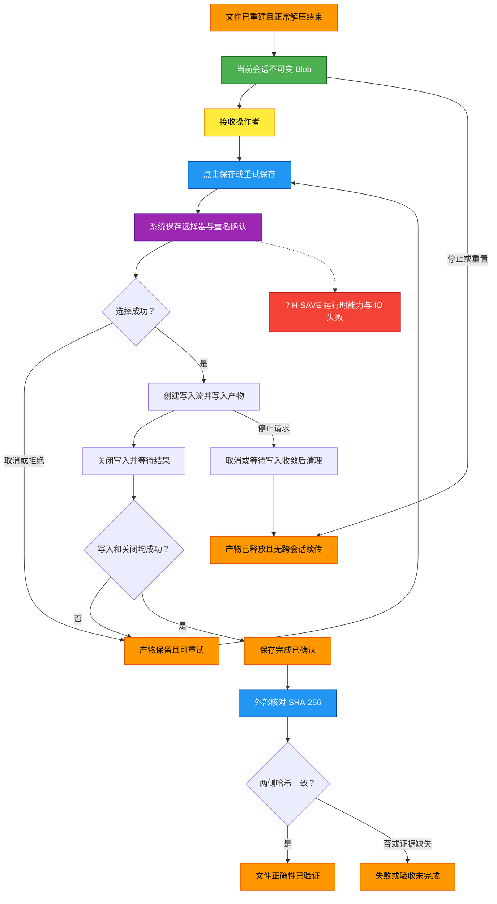

## 关键流程：本地模拟与现场交接

[Mermaid 源文件](processes/process-acceptance.mmd)

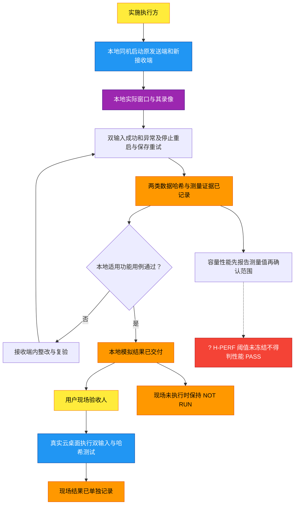

## 概念数据关系

[Mermaid 源文件](data/erd.mmd)

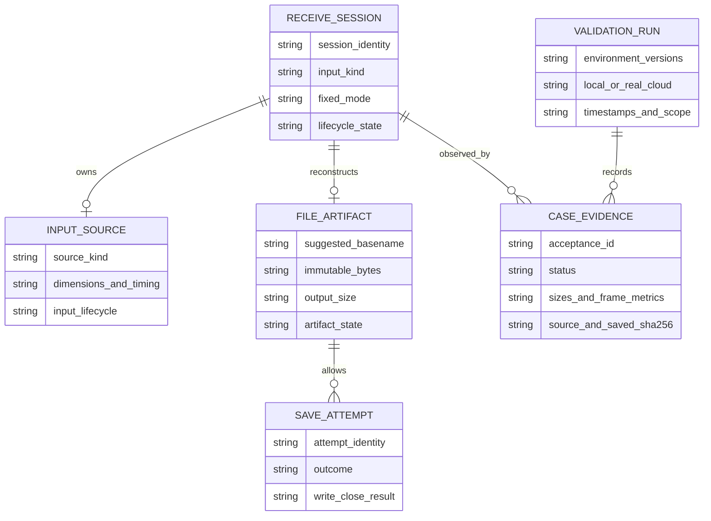

## 状态：接收会话

[Mermaid 源文件](data/state-session.mmd)

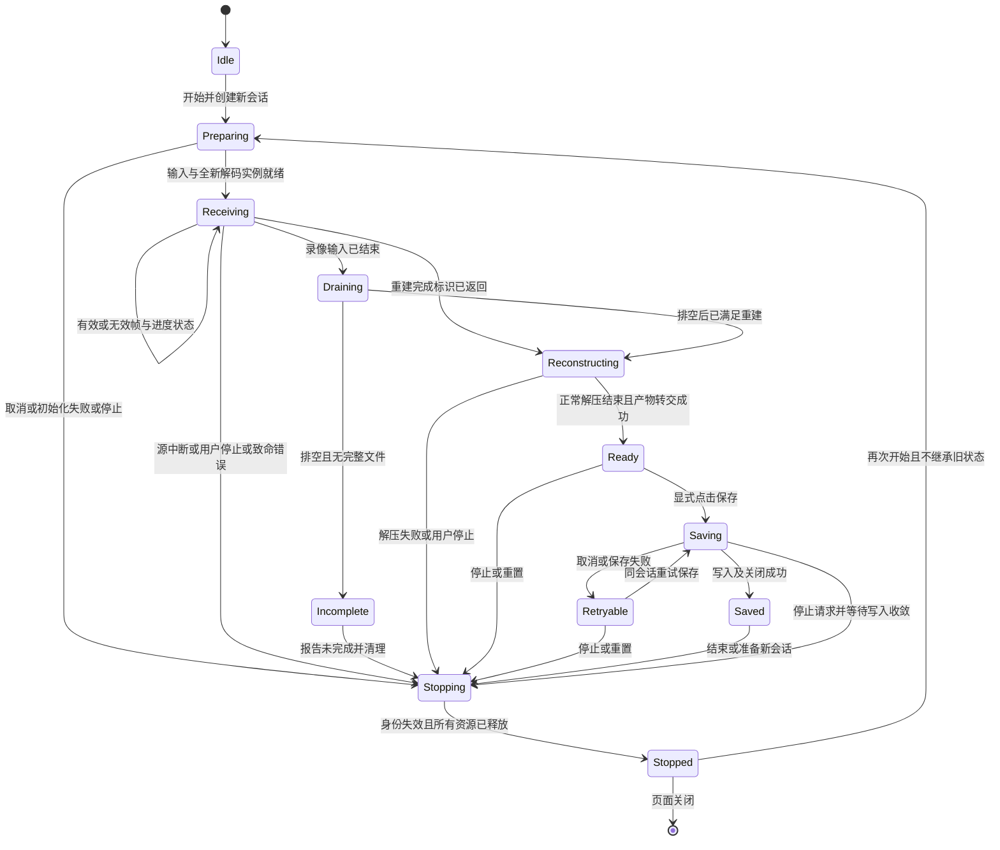

## 状态：文件产物

[Mermaid 源文件](data/state-artifact.mmd)

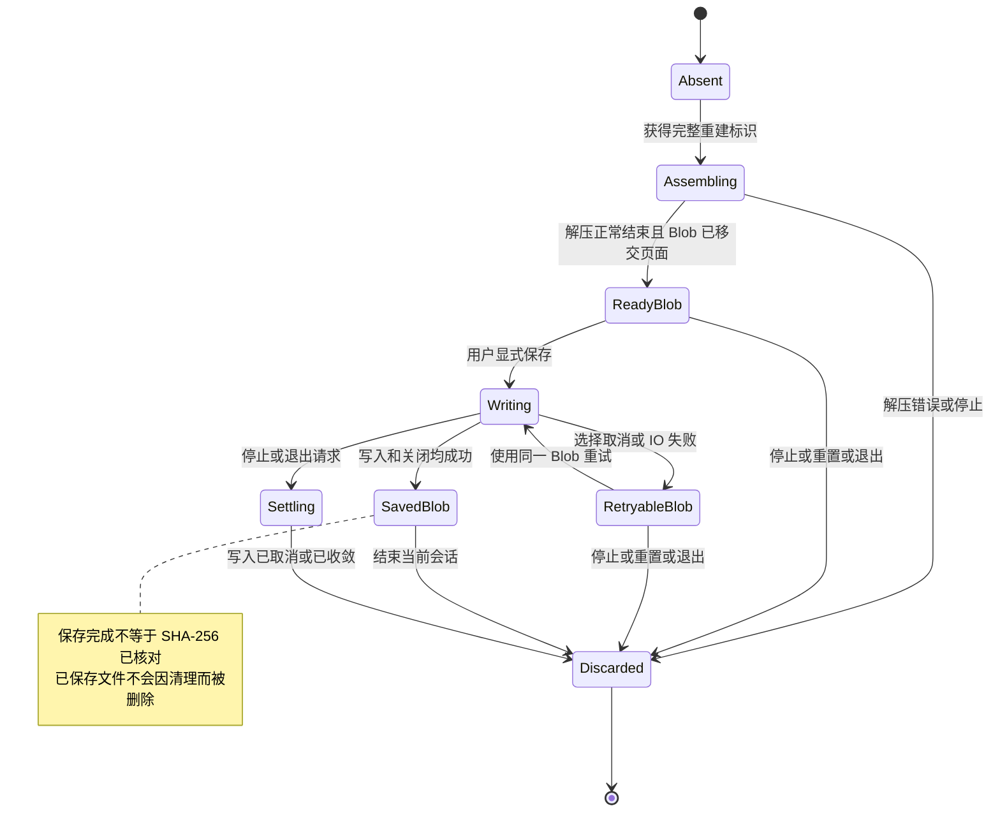

## 交互：实时启动与停止

[Mermaid 源文件](flows/sequence-live.mmd)

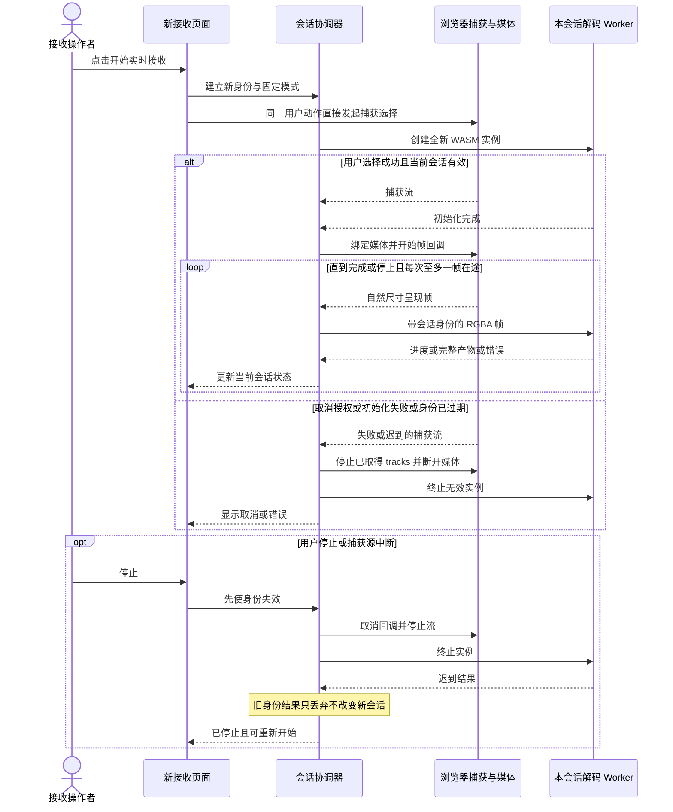

## 交互：录像排空与失败

[Mermaid 源文件](flows/sequence-video.mmd)

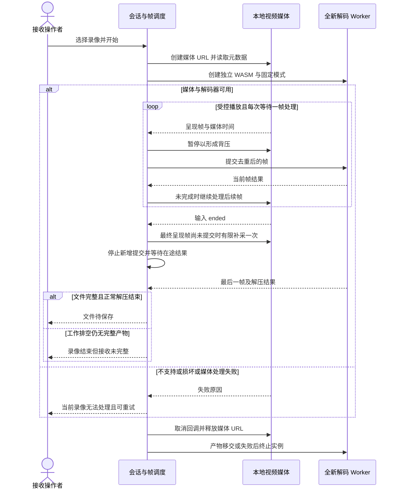

## 交互：保存与重试

[Mermaid 源文件](flows/sequence-save.mmd)

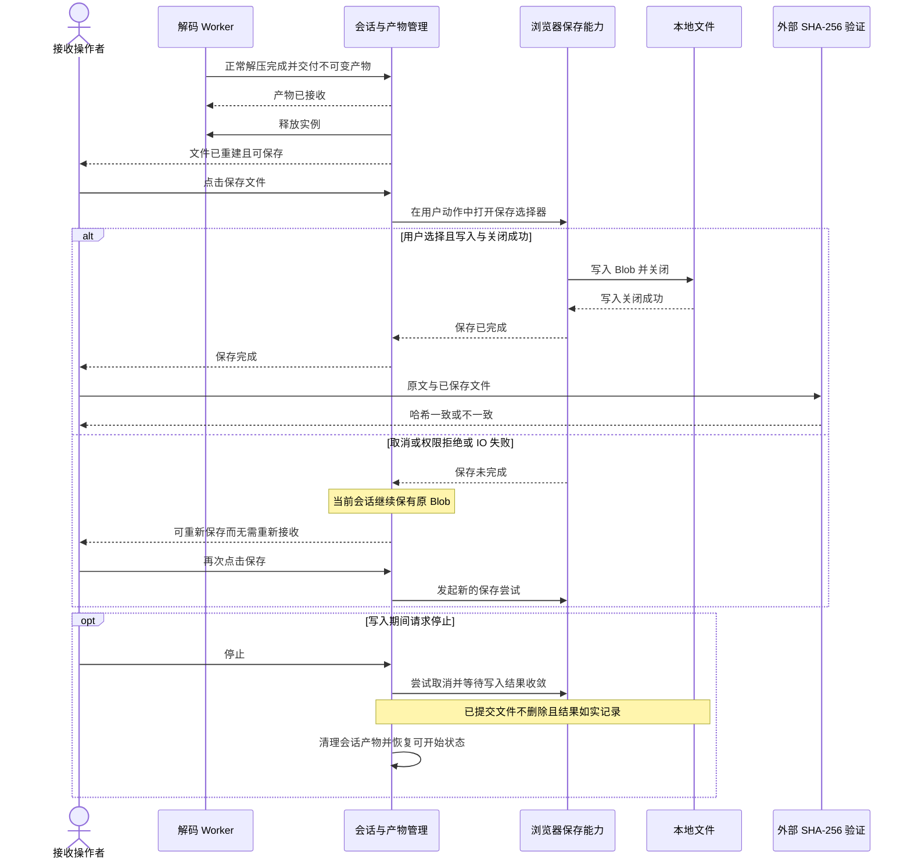

## 设计 QA 与下一步

设计覆盖 AC-001～AC-014；本地与现场结果分开。11 张图经 Mermaid 12.2.0 语法解析通过，独立源与本页嵌入一致，链接/编码/AC 追踪检查通过。语法检查不代表视觉渲染或产品运行验证，详见 [设计 QA](qa.md)。热点由已批准后测策略跟踪，不冒充通过。

本节点生效附加指令：新增宿主机双输入接收端；原发送端和协议复用，其余尽量不改；单文件、停止释放和保存重试；本地同机全功能测试先于用户现场；外部 SHA-256 和两类数据测量；容量性能先测后确认。

系统设计、阶段2.5契约和阶段3任务规划均已完成；具体任务与Claude续接见上述路线图。当前仅产出前段文档，未编写产品实现；writing-plans及以后由Claude管理，尚未启动。
