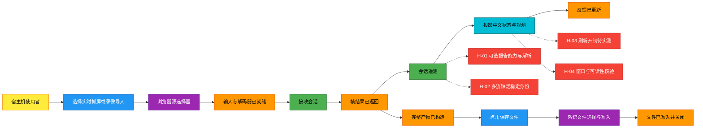
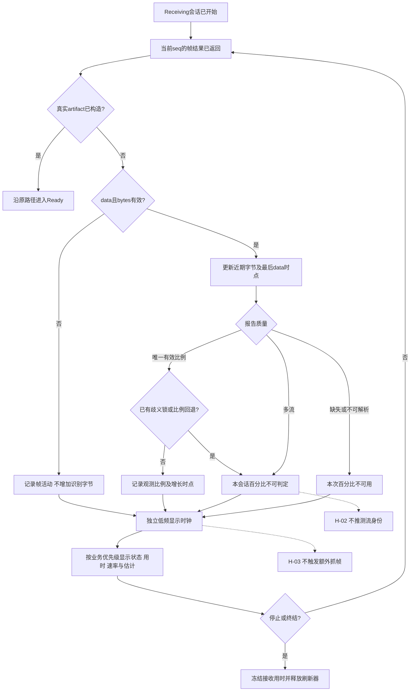
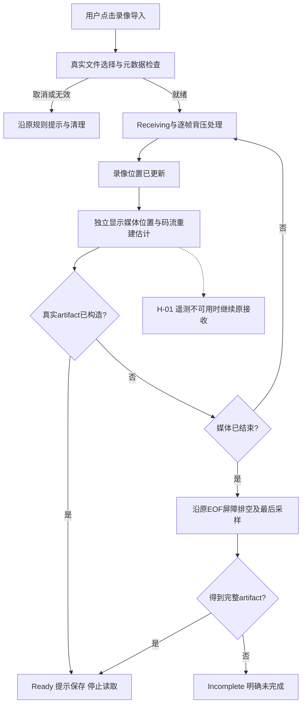
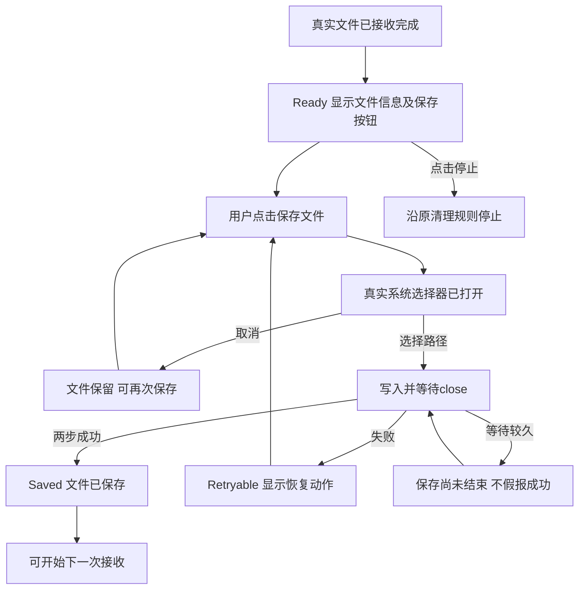
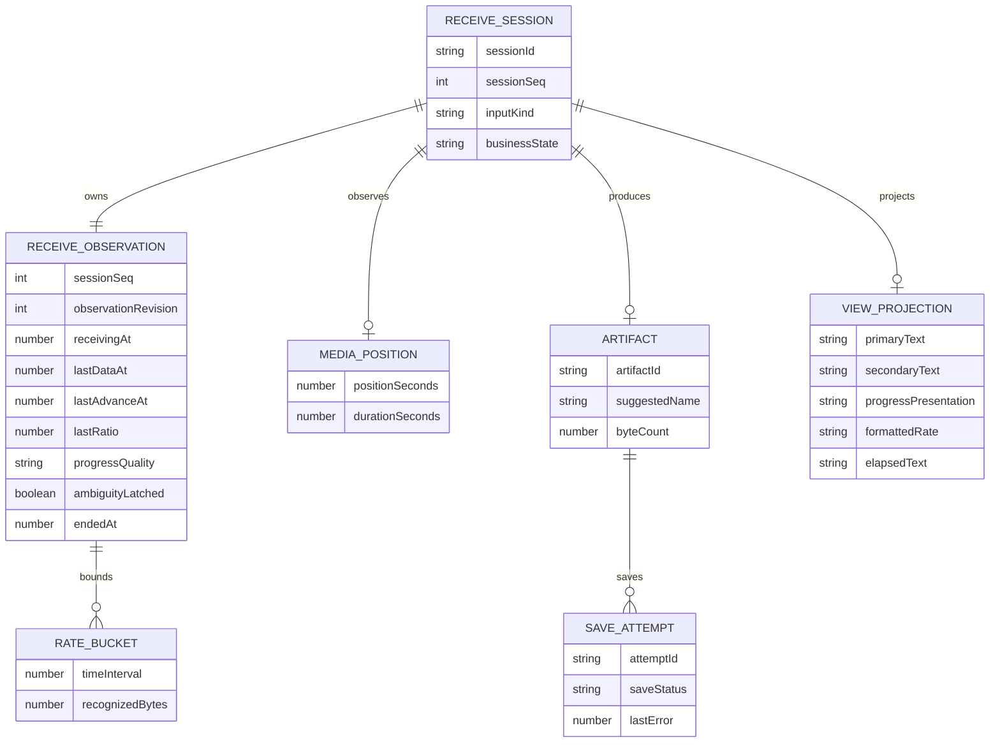
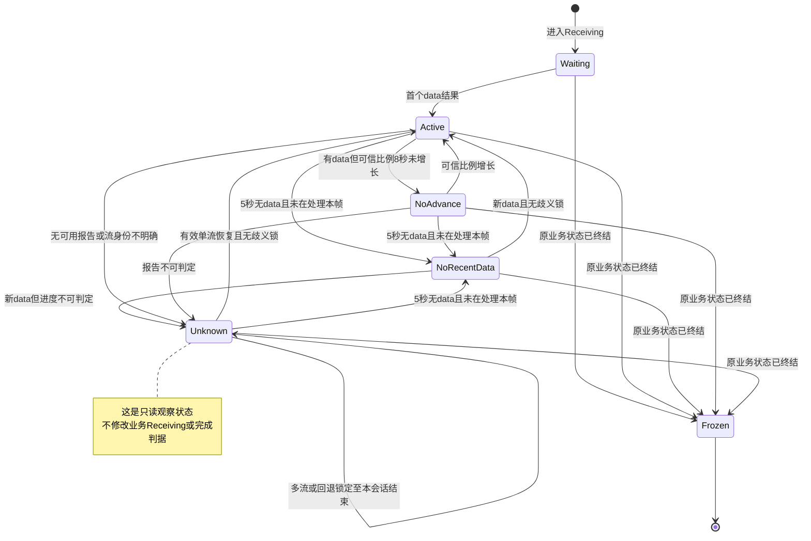
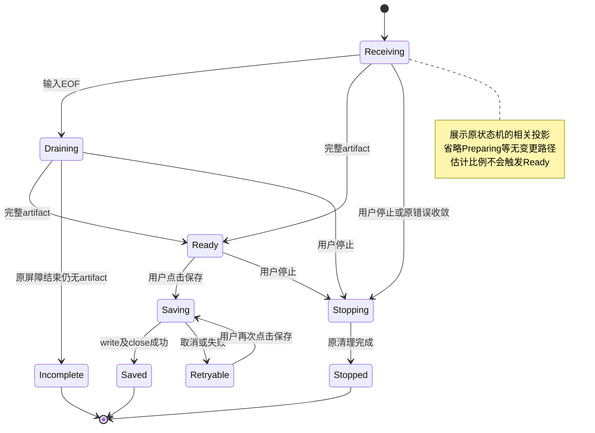
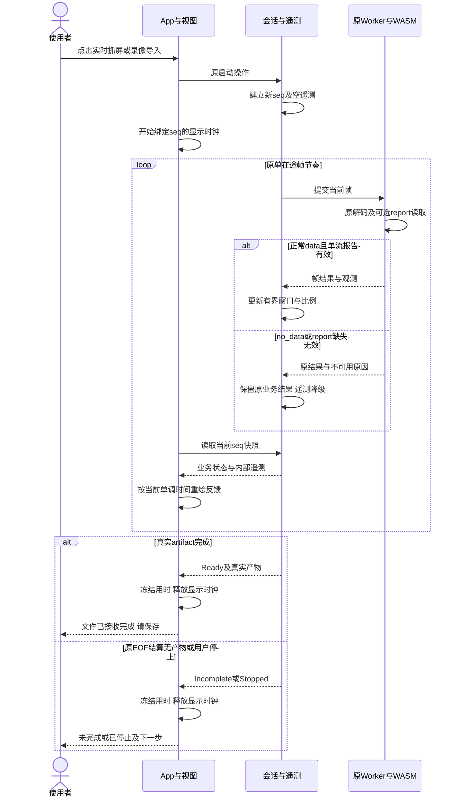
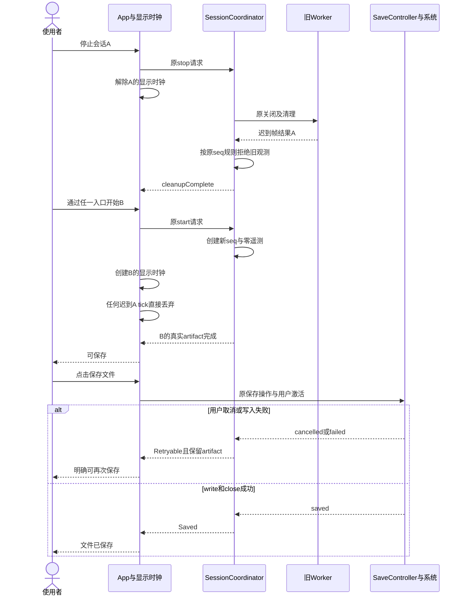

# 接收器体验 v2 — 系统设计目录

阶段2与2.5设计、阶段3路线图、阶段4实施计划及4.5 TDD规划已完成，待确认4.7真实E2E计划。基线：`9e4fbc46965de42b9b0097ad80c607d71c7303f0`。保留实时抓屏与录像导入两个独立入口，新增中文状态/时长/近期识别速率/重建估计。未修改产品代码。

## 从这里阅读

- [阶段2.5模块/接口/异常矩阵](module-contract-error-matrix.md)：六个内部动作、15项非致命诊断、时间窗口与所有权规则。
- [机器可读契约与样例](contracts/README.md) / [契约检查](contracts-qa.md) / [阶段2.5 Todo](contracts-todo.md)。
- [交互原型](prototype/index.html)：可直接打开，18种可切换演示状态；不采集屏幕、不读录像、不保存文件。
- [界面与状态说明](ui-spec.md)：沿用原深色/青色UI，双入口、录像位置、保存恢复及自适应安排。
- [架构与指标语义](architecture.md)：接线边界、速率/进度/时长口径、退化策略、生命周期及10条AC追踪。
- [设计输入与验证项](requirements.md)：已确认范围，H-01～04是后续技术验证项，无待用户回答的需求问题。
- [来源索引](sources.md) / [检查结果](qa.md) / [Todo](todo.md)。
- [已确认需求](../../requirements/receiver-ux-v2/requirements-spec.md) / [当前流水线](../../dev-pipeline/pipeline-state.json)。

## 设计摘要

既有会话仍决定何时接收、何时完成及保存；遥测只观察。进度来自可选WASM report，速度来自近期编码数据，录像位置独立。多流身份不明时不猜百分比，已有数据停止到达时速率自然归零。接收用时与保存耗时分开。

独立显示时钟不能触发抓屏/解码或系统选择器；新会话清零，旧结果与tick不能串入。活动预览保持可呈现以保护原录像逐帧回调。

## 图集合

以下9个Mermaid块与对应源文件全文一致；它们描述增量设计与既有行为的相关投影，不是新的实现或验收证明。

### 全局事件图

[独立源文件](big-picture.mmd)

### 接收反馈流程

[独立源文件](processes/process-receive.mmd)

### 录像位置与文件完成

[独立源文件](processes/process-video.mmd)

### 保存与恢复

[独立源文件](processes/process-save.mmd)

### 概念数据关系

[独立源文件](data/erd.mmd)

### 只读观测状态

[独立源文件](data/state-observation.mmd)

### 既有完成与保存状态的相关投影

[独立源文件](data/state-completion.mmd)

### 反馈交互与退化

[独立源文件](flows/sequence-feedback.mmd)

### 会话隔离与保存恢复

[独立源文件](flows/sequence-isolation.mmd)

## 下一阶段

[阶段3交付路线图](../../plans/receiver-ux-v2/roadmap.md)、[阶段4实施计划](../../plans/receiver-ux-v2/2026-10-24-receiver-ux-implementation.md)及[4.5测试规划](../../tests/receiver-ux-v2/README.md)已纳入10条AC、12类运行验证及H-03/04。[4.7真实操作计划](../../tests/receiver-ux-v2/e2e-user-journey-plan.md)已细化39旅程，本地32/用户现场7；[交接清单](../../tests/receiver-ux-v2/handoff.md)已确认通道A，Claude从阶段5实施。
