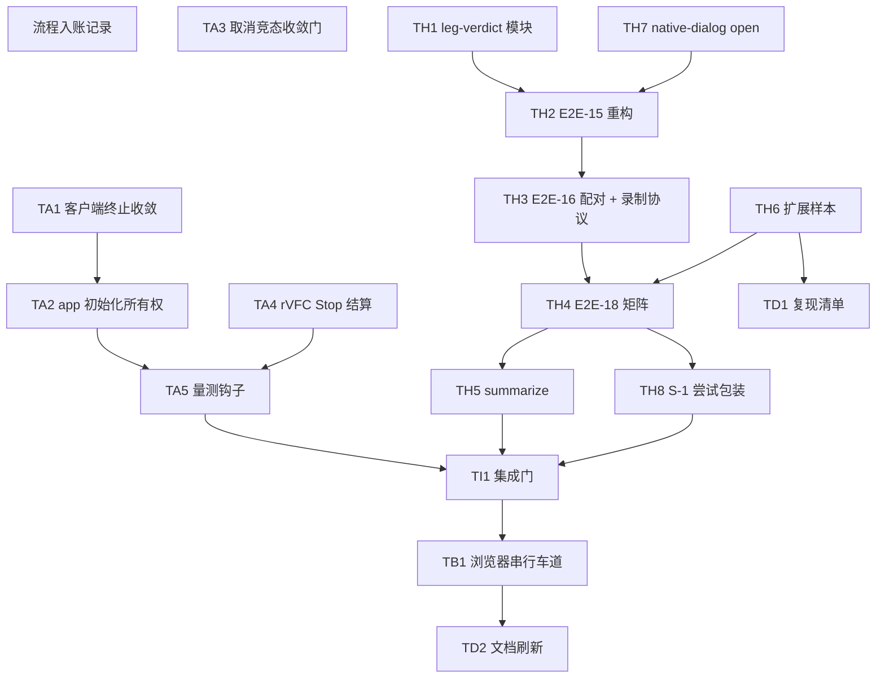

# Round-3 整改任务分解（dev-pipeline 阶段 6.5 Step B）

- 裁决输入：`docs/dev-pipeline/ext-review/round-3-verdict.md`（对应 Round-2 送审包；编号说明见裁决书正文——ext_rounds=2 → N=3，编排方已按实际路径入账，round-4 为下一送审轮）。
- Triage 输入：`docs/dev-pipeline/remediation/round-3-triage.md`（T1=A-R1/B-R1、T2=A-R2、T3=A-R3 全部确认；pushback 为空集；用户四项裁决已记录）。
- 已批准实施计划：`C:\Users\admin\.claude\plans\crispy-gliding-spring.md`（文件:行级修复点、Phase 结构、浏览器串行队列、E2E-18 腿矩阵均取自该计划）。
- 结构参照：`docs/plans/2026-10-18-desktop-receiver-implementation.md`（阶段 4 固定任务结构）。
- 覆盖要求：T1 ≥3 任务、T2 ≥4 任务、T3 ≥5 任务（本文件分别给出 3 / 6 / 5，见覆盖矩阵）；pushback 项零任务。
- 诚实守则（与计划「非目标」一致）：不冻结阈值、不传 `--thresholds`、性能保持 NOT_EVALUATED；不以样本大小声称最大容量；未执行腿写 NOT_RUN+依据，不以 TD 登记替代验收；不改发送端/协议/C++；不修改冻结计划文件；不把现场旅程（E2E-21..26）记为完成。

## 用户既定口径（执行时不得偏离）

1. 新建 `docs/tests/runs/20261021-teamexec-03/`；run-02 原始证据保留；新目录不得复制旧 PASS；每次尝试独立记录，异常退出不得留本次 PASS。
2. 先修判据 → 单元/集成绿 → 固定候选提交与页面/JS/WASM/profile/环境摘要 → 再跑 E2E-1..20 适用子项。C++/WASM 字节未变可明确引用历史 native 证据。
3. E2E-21..26 保持现场 NOT_RUN；E2E-20 最终打包留阶段 8。
4. 20MiB 可压缩超预算：记录实际产物预算、压缩前后尺寸、拒绝结果与随后的正常文件恢复；**像素预算拒绝不能代替产物预算拒绝**。20MiB 难压缩实时腿 NOT_RUN 带代码级依据。
5. 4MiB 难压缩录像：先做 **1MiB 有界探测**（预先声明录制时长/录像体积/导入等待上界）；记录原始/压缩尺寸、录像参数、处理耗时、真实保存、外部哈希；**失败归因分流**——无足量有效录像=装置/输入证据问题（NOT_RUN 注明阻塞），足量有效录像仍不能重建=接收端问题（作为新发现单独报告）。1MiB 成功≠最大容量；据实提范围修订案→用户确认→同步更新计划/决策记录/支持矩阵/门禁必测子项；历史结果不因修订改判。

## 覆盖矩阵（Blocking → 任务 ids）

| Blocking | 任务 ids | 数量校验 |
|---|---|---|
| A-R1（Worker 初始化失败未释放） | TA1、TA2、TA3 | T1 共 3 ✓ |
| B-R1（含子项 1 独立确认 A-R1、子项 2/3 取消竞态） | TA1、TA2、TA3 | 与 T1 同主题 |
| A-R2（规模/预算/量测未完成却登记完成） | TA5、TH4、TH5、TH6（执行与主张对齐另见 TB1、TD2） | T2 共 6 ✓ |
| A-R3（录像异常验收假绿 + 入口/末帧证据缺） | TH1、TH2、TH3、TH7、TB1（主张对齐另见 TD2） | T3 共 5 ✓ |
| S-1（旅程失败落盘） | TH8 | 建议项 |
| S-2（rVFC 主路径保护） | TA4 | 建议项 |
| S-3（可复核交付与文档快照） | TD1、TD2 | 建议项 |
| 流程（用户指令/编排要求） | T0 | 入账记录 |

Pushback：空集 → 无对应任务（明确不生成）。

## 新发现

1. **域 A 的 TDD RED 已在工作树中预置（未提交）**。规划核对时观察到：`web/desktop-recv/tests/unit/client.test.mjs` 的 UT-085..087、`session.test.mjs` 的 UT-066 修订与 UT-088/090/091、`ui.test.mjs` 的 UT-092、`video.test.mjs` 的 UT-093..095 已按裁决书 A-R1/B-R1/S-2 的期望写好，且 `decoder-client.js`/`app.js`/`session.test.mjs` 等文件近期被修改；但源码侧修复尚未落地（`decoder-client.js:109-113` 的 init-failed 分支仍无 terminate，`session.js` 的 startLive/startVideo 仍只看 `state`，`video-source.js` 的 `stop()` 仍不结算挂起 rVFC run）。这些预置内容与 TA1/TA3/TA4 的测试要求一致，属并行中的域 A 工作，**不是新 Blocking**。执行方开工前必须与团队核对工作树状态（未提交改动），避免重复创建同名用例或覆盖在途修改；本文件的任务字段以"应交付的结果"为准，不以"文件尚未存在"为前提。
2. 其余：规划过程中未发现超出 triage 确认范围的新问题。4MiB 难压缩录像腿的范围修订属用户既定处置流程（见 TH4/TB1），不计为新发现。

## Tasks

> 字段说明：`blocking:` 沿用裁决书原始编号；`depends_on:` 空 = 该波次内可并行；`resources:` 为独占资源声明（详见「资源域矩阵」）；`ac:` 为本任务对裁决书「期望/DoD」的落地判据；`evidence:` 为本任务必须交付的证据形态。

- [ ] **T0** 流程入账记录：verdict 已按实际路径入账（记录性任务，不修改状态文件） — type: process（流程任务，非 fix/test/regression/acceptance）
  - domain: 流程
  - blocking: —（无 Blocking；源自用户既定口径与编排要求，P0.1 已执行）
  - depends_on: —
  - resources: none(static)
  - files: 只读核对 `docs/dev-pipeline/pipeline-state.json`
  - fix points: 核对并记录现状：`external-review.verdict_files` 已含 `docs/dev-pipeline/ext-review/round-3-verdict.md`、`ext_rounds=3`、`external-review.status=failed`、`team-exec.status=in_progress`、notes 已记编号说明（pipeline-state.json:218、:227-238、:277）。本任务把"入账已完成"这一事实记入交接说明，不再改动状态文件（编排方职责）。
  - tests: —
  - verification: 人工核对 `pipeline-state.json` 的 verdict_files/ext_rounds/notes 与本文件一致 → 记录一致即通过
  - ac: 后续任务均以"verdict 已入账、流水线已回到 team-exec"为流程基线
  - evidence: 本条目 + `pipeline-state.json:235-238` 与 `:277` 的现状摘录
  - DoD: 不再有任务重复消费 verdict 或重开 review 轮次编号；round-4 为下一送审轮

- [ ] **TA1** decoder-client 终止收敛：init-failed 与帧通道 postMessage 异常全部 terminate — type: fix
  - domain: A（产品代码）
  - blocking: A-R1、B-R1（子项 1）
  - depends_on: —
  - resources: `files:web/desktop-recv/src/decoder-client.js, web/desktop-recv/worker/decoder-worker.js, web/desktop-recv/tests/unit/client.test.mjs, web/desktop-recv/tests/browser/wasm-roundtrip.mjs, web/desktop-recv/tests/browser/digest-mismatch.mjs`；`git-index`（提交临界区，见资源域说明）
  - files: Modify `web/desktop-recv/src/decoder-client.js`（:109-113 init-failed 分支；:87-99 submitFrame 的 postMessage catch）；Read/Modify `web/desktop-recv/worker/decoder-worker.js`（:95-102 settle_init(false)）；Test/Modify `web/desktop-recv/tests/unit/client.test.mjs`、`tests/browser/wasm-roundtrip.mjs`/`digest-mismatch.mjs`
  - fix points:
    1. `decoder-client.js:109-113`：`init-failed` 分支从 `_settleInit(error)+_failAll(error)` 改走 `_channelFailed(error)`（内含 terminate；ready 前不触发 onFailure）。
    2. `decoder-client.js:87-99`：帧 `postMessage` 抛错的 catch 同样收敛到 `_channelFailed`（当前只 reject 该帧，未 terminate 整通道）。
    3. 保留 `_settleInit` 单次结算语义（晚到 `ready` 不能复活已超时 init）；`_channelFailed` 的 terminate 幂等。
    4. `worker/decoder-worker.js`：`settle_init(false)` 后不再处理 frame/init 消息（只等待主线程 terminate 或 close）；不要求 worker 自 terminate。
    5. `tests/browser` 的 digest-mismatch 用例去掉 `finally { client.close() }` 掩护，直接断言 `terminate` 被调用（真实 Worker 路径）。
  - tests: UT-085（协议 init-failed → terminate + init 以 worker 码 reject + ready 前 onFailure 静默）、UT-086（init postMessage 抛错 → terminate）、UT-087（帧 postMessage 抛错 → 全通道收敛 + terminate + onFailure 恰一次）；browser digest-mismatch 真实终止断言
  - verification: `node tools\desktop-recv\run-unit.mjs --suite client --suite worker` → exit 0，UT-085..087 实跑通过；完整门 `node tools\desktop-recv\run-unit.mjs --all` → exit 0（TI1 复跑）
  - ac: 初始化期所有出口（协议拒绝 15002/18002 等、创建/init 抛错、超时、postMessage 抛错）都结算并释放对应 Worker 实例；连续失败重试 3 次的创建/终止计数一致（裁决书探针 terminated=[0,0,0] 的缺陷关闭）；不能只断言 Promise 已 reject
  - evidence: UT-085..087 执行输出（exit 0 + terminate/计数断言）；digest-mismatch 用例 diff 与运行输出
  - DoD: A-R1/B-R1 子项 1 的 DoD 满足；资源清理与 `cleanupComplete` 语义一致

- [ ] **TA2** app.js 初始化期所有权：init 拒绝即由创建者关闭 client — type: fix
  - domain: A（产品代码）
  - blocking: A-R1、B-R1（子项 1）
  - depends_on: TA1
  - resources: `files:web/desktop-recv/src/app.js`；`git-index`
  - files: Modify `web/desktop-recv/src/app.js`（:55-68 createClient）
  - fix points:
    1. `createClient` 内 `await client.init(...)` 拒绝时 `client.close()` 后再抛出，使 app（创建者）承担 init 期所有权；协调器拿不到引用的窗口期不再泄漏。
    2. 覆盖全部拒绝入口：协议 init-failed、WASM 初始化失败、摘要失配、缺导出、超时（15011）、postMessage 抛错（15010）。
    3. 成功路径不改变现有 attach 语义（client 交给协调器后由协调器负责释放）。
  - tests: 由 TA1 的 client 用例 + TA3 的协调器装配用例覆盖；本任务以集成门与 E2E-4 验证装配后无遗留 Worker
  - verification: `node tools\desktop-recv\run-unit.mjs --all` → exit 0；TB1 的 E2E-4（真实浏览器验证新清理门）PASS
  - ac: init 拒绝后 app 侧不再存在无主 client；连续重试的创建/关闭计数与快照一致
  - evidence: `app.js` diff；UT-085..091 组合输出；E2E-4 记录
  - DoD: 裁决书 A-R1「明确初始化期间 Worker 的所有者」在 app 层成立

- [ ] **TA3** session/ui 取消竞态收敛门：未收敛前不得新启 — type: fix
  - domain: A（产品代码）
  - blocking: A-R1、B-R1（子项 2/3）
  - depends_on: —
  - resources: `files:web/desktop-recv/src/session.js, web/desktop-recv/src/ui.js, web/desktop-recv/tests/unit/session.test.mjs, web/desktop-recv/tests/unit/ui.test.mjs`；`git-index`
  - files: Modify `web/desktop-recv/src/session.js`（:166 startLive、:116 startVideo、:79-89 _track、:263 _captureRejected 保持）；Modify `web/desktop-recv/src/ui.js`（:37-53 deriveControls）；Test `tests/unit/session.test.mjs`、`tests/unit/ui.test.mjs`
  - fix points:
    1. `startLive`/`startVideo` 在 `_pending.size > 0` 时拒绝：`{ accepted: false, reason: 'cleanup' }`，不进入捕获阶段（当前只检查 `_session.state`，取消后状态已回 Idle 而 init 仍挂起，pending 1→2 被放行）。
    2. `_track`（:79-89）在 pending 清空且 `state !== 'Stopping'` 时补发一次快照（否则 UI 永久禁用/`cleanupComplete` 不更新）。
    3. `_captureRejected`（:263）保持现状（Idle + 错误 + releaseInputs）。
    4. `ui.js deriveControls`：`canStart`/`canImportVideo` 纳入 `snapshot.cleanupComplete !== false`，避免"按钮可点但协调器会拒"或反之。
    5. 收敛后合法重启必须被放行（attachCapture 已等待 btn-live 可用，旅程用等待而非失败）。
  - tests: UT-088（取消期重启被拒 reason='cleanup' + 晚到 client 关闭 + 收敛后放行 + 不创建第二个 decoder）、UT-089（三轮取消创建/关闭计数一致，重写 UT-066）、UT-090（Stopping 中 init 拒绝静默）、UT-091（startVideo 同门）、UT-092（ui cleanupComplete 阻断开播/导入）
  - verification: `node tools\desktop-recv\run-unit.mjs --suite session --suite ui` → exit 0；`--all` → exit 0
  - ac: 取消后仍可并行积累未决实例的路径关闭（裁决书探针 `Idle, cleanupComplete=false, canStart=true` → `accepted=true`、pending 1→2 不再出现）；创建/关闭计数与快照一致；UI 与协调器都在清理收敛后才允许新会话；只改按钮而保留可调用入口竞态不算完成
  - evidence: UT-088..092 输出；`session.js`/`ui.js` diff
  - DoD: B-R1 子项 2/3 的关闭条件（取消时立即取消所拥有的初始化，或保持可证实的清理状态）成立

- [ ] **TA4** rVFC 主路径 Stop 结算与回调异常保护（S-2） — type: fix
  - domain: A（产品代码）
  - blocking: —（S-2 建议）
  - depends_on: —
  - resources: `files:web/desktop-recv/src/video-source.js, web/desktop-recv/tests/unit/video.test.mjs`；`git-index`
  - files: Modify `web/desktop-recv/src/video-source.js`（:144 起 `_runFrames`、:161-195 回调体、:255-275 `stop()`）；Test `tests/unit/video.test.mjs`
  - fix points:
    1. 帧回调体整体 try/catch：同步异常不逃出回调，按 13002 走 `failRun` 结算。
    2. `stop()` 主动结算挂起的 rVFC run（`cancelVideoFrameCallback`/主动 finishRun），run 不保持 pending。
    3. `ended`/`error` 监听随结算移除（当前 `ended` 以 once 注册但 finishRun 不移除）。
    4. 异常后 `run()` 的 reject 路径与 app.js 的 13002 收敛保持兼容（不改既有错误码语义）。
  - tests: UT-093（回调同步抛错 → run 以 13002 reject，不挂起）、UT-094（Stop 结算等待回调的 run）、UT-095（结算时移除 ended/error 监听）
  - verification: `node tools\desktop-recv\run-unit.mjs --suite video` → exit 0；`--all` → exit 0
  - ac: 受控注入 capture 抛异常后，异常不逃出回调、run 不保持 pending；Stop 后可立即重启
  - evidence: UT-093..095 输出；`video-source.js` diff
  - DoD: S-2 的"故障/Stop 回归并处理回调归属"完成；seek fallback 单测不作为本项替代证据

- [ ] **TA5** 量测钩子：render/video/save 的时刻边界与字节交付 — type: fix
  - domain: A（产品代码）
  - blocking: A-R2
  - depends_on: TA2、TA4（`app.js` 与 `video-source.js` 串行；同一文件的波次串行规则）
  - resources: `files:web/desktop-recv/src/app.js, web/desktop-recv/src/save-controller.js, web/desktop-recv/src/video-source.js, web/desktop-recv/src/contract-snapshot.js`；`git-index`
  - files: Modify `web/desktop-recv/src/app.js`（render）、`web/desktop-recv/src/contract-snapshot.js`（如字节字段需透出）、`web/desktop-recv/src/save-controller.js`、`web/desktop-recv/src/video-source.js`
  - fix points:
    1. `render()` 暴露 `__lastStats` / `__state` / `__statusTrail`（有界）/ `__journey`（initStart/Ready/Receiving/Saved 首时刻）。
    2. 暴露 `__contractSnapshot`：含 `artifact.byteCount` 与 `compressedBytes`（与冻结契约字段名一致）。
    3. `startVideoImport` 维护 `__videoTimeline{attemptId, presented, firstUs, lastUs, endReason, artifactFrameId, finalSample}`。
    4. `saveController` 记 `saveRequestAt` / `writeCloseAt`。
    5. 仅为可观测性暴露，不改变任何行为或状态机语义；字段有界（statusTrail 不得无限增长）。
  - tests: 在对应套件补钩子存在性与形状断言（不改变行为断言）；钩子消费方验证在 TH2/TH4/TB1
  - verification: `node tools\desktop-recv\run-unit.mjs --all` → exit 0；TB1 实跑中 `pageState` 能读到上述字段（TH2/TH4 的记录可见）
  - ac: 一次往返中可读到初始化/有效输入/重建/保存四类时刻边界与原始/压缩字节；无字段时记录侧如实 NOT_RUN，不得补造
  - evidence: diff + TB1 记录中实际出现的 timeline/measurement 字段
  - DoD: A-R2 要求的"逐项交付尺寸、profile、时间边界、耗时和哈希"有真实数据源

- [ ] **TH1** 新建 `leg-verdict.mjs`：视频异常腿/预算腿裁决模块 + 反例回归 — type: test
  - domain: H（装置/门禁）
  - blocking: A-R3
  - depends_on: —
  - resources: `files:tools/desktop-recv/e2e/leg-verdict.mjs(新建), web/desktop-recv/tests/unit/leg-verdict.test.mjs(新建), tools/desktop-recv/run-unit.mjs(套件登记)`；`git-index`
  - files: Create `tools/desktop-recv/e2e/leg-verdict.mjs`、`web/desktop-recv/tests/unit/leg-verdict.test.mjs`；Modify `tools/desktop-recv/run-unit.mjs`（ALL_SUITES 增加 `leg-verdict`，显式枚举）
  - fix points:
    1. `evaluateVideoFailureLeg({ attemptIdAdvanced, logDelta, terminalState, btnVideoEnabled, cleanupComplete })`：四条判据全过才算腿 PASS——a) 本次导入被摄入（attemptId 推进 + 状态离开 Idle）；b) 日志**增量**含预期码（empty/text → 13005，corrupt → 13002|13003）；c) 回到可重启终态且 `btn-video` 可用、`cleanupComplete=true`；d) 增量无 `already active`。
    2. `evaluateBudgetLeg(...)`：15008 拒绝 → 停止 → 随后正常文件恢复的腿判定。
    3. 单测必含裁决书反例回归：**旧错误日志存在、当前仍 Preparing（saveDisabled=true）必须 FAIL**（现状 `run-e2e.mjs:728 waitFor` 扫描累计 log + `saveDisabled` 当终态，旧错误足以让未结束的导入 PASS）。
    4. 纯函数、无 DOM/IO，可被 run-e2e 与单测共同引用。
  - tests: 反例回归（旧错误+Preparing → FAIL）、空/非视频/截断容器的正例、budget 腿正/负例、`already active` 判负
  - verification: `node tools\desktop-recv\run-unit.mjs --suite leg-verdict` → exit 0；`--all` → exit 0 且套件数 9→10
  - ac: 裁决书 A-R3 核心反例（真实函数回放返回 true/PASS）在单测层被固定为 FAIL；腿裁决不依赖累计日志
  - evidence: 模块 + 单测输出（含反例回归用例名与 exit 0）
  - DoD: A-R3「补『旧错误存在、当前仍 Preparing』必须失败的回归」完成

- [ ] **TH2** E2E-15 重构：逐腿判定 + 真实入口腿 + pageState 扩展 — type: fix
  - domain: H（装置/门禁）
  - blocking: A-R3
  - depends_on: TH1、TH7（真实入口腿依赖 `native-dialog.ps1 open/open-cancel`）
  - resources: `files:tools/desktop-recv/e2e/run-e2e.mjs`；`git-index`
  - files: Modify `tools/desktop-recv/e2e/run-e2e.mjs`（:95-118 pageState；:1577-1607 E2E-15；:700-713 importVideo 保留为批量腿）
  - fix points:
    1. `pageState` 扩展：`state/attemptId/statusTrail/journey/videoTimeline/saveTimeline/videoDisabled/contractSnapshot`（读取 TA5 的 `__*` 钩子；缺字段返回 null，不补造）。
    2. E2E-15 三个异常腿（空/非视频/截断容器）改用 `evaluateVideoFailureLeg` 逐腿判定；**每腿验证恢复**（腿后回到可重启终态且下一腿可导入），不是最后只恢复一次。
    3. 新增真实入口腿：点 `#btn-video` → helper `open-cancel` → Idle 且无新错误日志 → 再点 → helper `open` 选 `V-GOOD-C.webm` → 日志出现 `recording:` 增量 → 恢复往返哈希相等。`open` 对话框 edit id=1001 未验证 → 三级回退（Win32 id → UIA 名称 → 焦点粘贴）；仍失败 → 真实入口腿 NOT_RUN 带 helper 诊断，**E2E-15 不得 PASS，如实上报**。
    4. 批量腿（DataTransfer 注入）保留，并在记录中标注"仅导入路径证据"；不支持格式不可构造时明确标未测。
    5. 运行目录参数化：`run-e2e.mjs` 顶部 `RUN` 常量当前硬编码 run-02 目录（:28）→ 增加 `--run <runId>`（或等价）并默认指向 20261021-teamexec-03；禁止把 run-03 结果混写 run-02（用户口径 1）。
  - tests: 由 TH1 单测 + TB1 实跑共同验证；E2E-15 记录逐腿 outcomes
  - verification: TB1 车道内 `node tools\desktop-recv\e2e\run-e2e.mjs --case E2E-15 --source window` → `CASE E2E-15 PASS`、exit 0（或按失败如实 FAIL）
  - ac: 每个异常分支独立判定并通过/失败；旧错误日志不能让当前 Preparing 的导入通过；取消/重选是真实入口操作证据而非 DataTransfer 替代
  - evidence: `run-e2e.mjs` diff；E2E-15 的 results.json 记录（各腿 attemptId/logDelta/终态）+ proof
  - DoD: A-R3 的「真实入口执行取消/重选、逐异常分支恢复并保存校验」完成

- [ ] **TH3** E2E-16 配对时间线判据 + record-sender V-LAST 录制协议 — type: fix
  - domain: H（装置/门禁）
  - blocking: A-R3
  - depends_on: TH2（同一文件串行）
  - resources: `files:tools/desktop-recv/e2e/run-e2e.mjs, tools/desktop-recv/e2e/record-sender.mjs`；`git-index`
  - files: Modify `tools/desktop-recv/e2e/run-e2e.mjs`（:1609-1670 E2E-16）；Modify `tools/desktop-recv/e2e/record-sender.mjs`（:229-243 V-LAST 录制、manifest、`--without-seconds`）
  - fix points:
    1. E2E-16 配对判据：`with` 腿完成时刻 `T*` 用 `lastUs + artifactFrameId` 估计且 `__mediaEnded=null`（未到真 EOF 即完成）；`without` 腿真 EOF（`endReason='eof'`）+ `lastUs < T*` + 无 artifact；**有效性判据 `T* > without 时长`**，不满足则调 `--without-seconds` 重录；仍不成立 → E2E-16 如实 FAIL（不得改成 PASS）。
    2. 记录 `ended/最后 frameId/解码/排空` 时间线（来自 TA5 的 `__videoTimeline`）入 results.json。
    3. `record-sender.mjs`：每段 V-LAST 录制前 reload 发送端（两段同起点）；写 manifest（payload sha256、各段字节/哈希/时长/senderTicks、命令行）；媒体目录参数化到 run-03（当前 :16 硬编码 run-02 fixtures-media）。
    4. `--without-seconds` 保持可调（已存在，:35）。
  - tests: 由 TB1 实跑验证配对；单测层由 leg-verdict/记录字段透传覆盖
  - verification: 车道内 `record-sender --only last` 成功产出 manifest；`run-e2e.mjs --case E2E-16 --source window` → PASS、exit 0（配对不成立时如实 FAIL）
  - ac: 长/短片差异可追溯到"最后关键有效帧的保留/去除"，而非两段独立录制的偶然差异；`T*` 与 `without` 时长的因果关系有记录
  - evidence: 配对两段 media 的 manifest（含 sha256/时长）+ E2E-16 时间线记录
  - DoD: A-R3「制作可核验的最后关键帧对照（共享前缀或等价可追溯构造），记录真实 EOF/在途排空顺序与落盘哈希」完成

- [ ] **TH4** E2E-18 腿矩阵 + 嵌套 measurement + evidence 透传 — type: fix
  - domain: H（装置/门禁）
  - blocking: A-R2
  - depends_on: TH3（run-e2e 串行）、TH6（样本档位与 manifest）
  - resources: `files:tools/desktop-recv/e2e/run-e2e.mjs, tools/desktop-recv/e2e/evidence.mjs`；`git-index`
  - files: Modify `tools/desktop-recv/e2e/run-e2e.mjs`（:2014-2033 E2E-18）；Modify `tools/desktop-recv/e2e/evidence.mjs`
  - fix points:
    1. E2E-18 改为腿矩阵执行，记录嵌套 `measurement.legs[]`（当前只有 1MiB 实时 1 轮 + notes 里"IAT/14002 unit coverage"替代预算恢复）。
    2. 腿矩阵（与批准计划一致，不增删档位）：
       | 输入 | 数据类 | 档位 | 处置 |
       |---|---|---|---|
       | 实时 | 可压缩/难压缩 | 1MiB、4MiB | 执行 |
       | 录像 | 可压缩 | 4MiB（编码流小，可录）+ 现有档位 | 执行 |
       | 录像 | 难压缩 | 128KiB（现有）+ **1MiB 有界探测** | 执行/探测 |
       | 录像 | 难压缩 | 4MiB | 待探测结论：可行→执行；不可行→NOT_RUN 带依据入记录 + 范围修订案待用户确认 |
       | 实时 | 可压缩 | 20MiB 超预算 | 执行：15008 拒绝→停止→正常文件恢复 |
       | 实时 | 难压缩 | 20MiB 超预算 | NOT_RUN 带代码级依据（无早期尺寸检查，需全流传输） |
    3. 1MiB 难压缩录像有界探测：**探测前**在记录中声明录制时长/录像体积/导入等待上界；记录原始/压缩尺寸、录像参数、处理耗时、真实保存、外部哈希；失败按用户口径分流归因（装置/输入问题 vs 接收端问题，后者作为新发现单独报告）；1MiB 成功≠最大容量。
    4. 20MiB 可压缩超预算腿：产物预算拒绝（15008）后停止并恢复正常文件往返；**像素预算拒绝不得替代产物预算拒绝**；记录原始/压缩尺寸。
    5. 20MiB 难压缩实时腿 NOT_RUN 的依据：`build_artifact` 仅在全部解码后调用（`web/desktop-recv/worker/decoder-worker.js:209/:334`），无早期尺寸检查，需全流传输（与批准计划风险表一致）。
    6. `evidence.mjs`：记录携带 `attemptId` 与嵌套 `measurement` 块；顶层 NOT_RUN 规则不被破坏（gate 语义不变）。
  - tests: 记录字段透传单测（evidence 套件）；腿矩阵由 TB1 实跑
  - verification: TB1 车道内 `run-e2e.mjs --case E2E-18 --source window` → PASS/FAIL 按腿；records 含 `measurement.legs[]`
  - ac: 所有计划腿有明确状态（PASS/FAIL/NOT_RUN+依据）；执行腿有尺寸/profile/时间边界/耗时/哈希；4MiB 难压缩录像腿处置遵循用户批准探测协议，不擅自改范围
  - evidence: E2E-18 results.json + `measurement.legs[]` + 探测声明与结论 + 20MiB 超预算拒绝/恢复 proof
  - DoD: A-R2「补可承载范围内两类扩展样本的双输入往返、实际可构造预算拒绝后的正常恢复，逐项交付尺寸、profile、时间边界、耗时和哈希」完成

- [ ] **TH5** summarize.py：measurements.json + measurement-report.md — type: fix
  - domain: H（装置/门禁）
  - blocking: A-R2
  - depends_on: TH4（记录 `measurement` 字段定义）
  - resources: `files:tools/desktop-recv/summarize.py`；`git-index`
  - files: Modify `tools/desktop-recv/summarize.py`
  - fix points:
    1. 读 `results.json` 的 `record.measurement`（含嵌套 legs）→ 生成 `measurements.json` 与 `measurement-report.md`。
    2. 四类时间边界定义精确化（初始化 / 有效输入 / 重建 / 保存），吞吐公式与时段清楚；系统对话框等待不混成解码速度。
    3. NOT_RUN 行带依据；头部固定"性能 NOT_EVALUATED（阈值未冻结）"。
    4. 不引入 `--thresholds`；不把缺项改绿（gate 语义不变）。
  - tests: 由证据套件 + TB1 实跑验证
  - verification: `python tools\desktop-recv\summarize.py --run docs\tests\runs\20261021-teamexec-03` → exit 0，产出两文件；性能条目全部 NOT_EVALUATED
  - ac: 汇总完全由真实记录生成；尺寸/时间边界/耗时/哈希齐备；run-02 的"NOT_EVALUATED 空表"问题不再出现
  - evidence: `measurements.json`、`measurement-report.md`、命令输出
  - DoD: A-R2 的量测交付物落地（阈值仍不冻结）

- [ ] **TH6** create-fixtures `--extended`：1/4MiB 双类 + 20MiB 超预算样本 + manifest — type: test
  - domain: H（装置/门禁）
  - blocking: A-R2
  - depends_on: —
  - resources: `files:tools/desktop-recv/create-fixtures.py`；`git-index`
  - files: Modify `tools/desktop-recv/create-fixtures.py`
  - fix points:
    1. `--extended` 生成 1MiB/4MiB 可压缩与难压缩样本（种子确定性）；20MiB 可压缩超预算样本；manifest 记路径/类/尺寸/sha256。
    2. 保持既有默认行为不变（不带 `--extended` 时输出与现在一致）；不生成录像（录像来自真实录制）。
    3. 与 run-03 fixtures 目录布局兼容（供 TH4/TB1 引用）。
  - tests: manifest 哈希复算一致性（脚本自检输出）
  - verification: `python tools\desktop-recv\create-fixtures.py --root docs\tests\runs\20261021-teamexec-03\fixtures --seed 20261018 --extended` → exit 0；重跑后 manifest sha256 完全一致
  - ac: 两类数据两档位与 20MiB 超预算样本可用且确定性；不伪造编码压缩尺寸或录像
  - evidence: manifest.json + 两次运行哈希一致的复算输出
  - DoD: A-R2 的"两类扩展样本"输入前提成立

- [ ] **TH7** native-dialog.ps1：真实录像入口 `open` / `open-cancel` 动作 — type: fix
  - domain: H（装置/门禁）
  - blocking: A-R3
  - depends_on: —
  - resources: `files:tools/desktop-recv/e2e/native-dialog.ps1`；`git-index`
  - files: Modify `tools/desktop-recv/e2e/native-dialog.ps1`（当前 ValidateSet 仅 save/share/share-cancel/save-cancel/stop-share）
  - fix points:
    1. 新增 `open`：复用 `FindSaveDialog`/`FindEdit1001`/粘贴+Enter 机制驱动录像文件选择对话框；edit id=1001 未验证 → 三级回退（Win32 id → UIA 名称 → 焦点粘贴）。
    2. 新增 `open-cancel`：Cancel（id=2）关闭对话框，不选文件。
    3. 成功只以应用侧 `change` 证据判定（helper 自身不得宣告导入成功）。
    4. 失败 exit 1 并输出对话框诊断（dump 保留），供 TH2 将真实入口腿标 NOT_RUN。
  - tests: 无单测（系统对话框）；由 TH2 真实入口腿与 TB1 实跑验证
  - verification: TB1 车道内 E2E-15 真实入口腿产出 `recording:` 日志增量与恢复往返（helper exit 0）；失败时诊断留档
  - ac: 用户点击录像入口、取消系统选择器并重选的操作路径可被真实驱动或如实 NOT_RUN；不可用时不伪造通过
  - evidence: `native-dialog.ps1` diff + E2E-15 真实入口腿 proof/诊断
  - DoD: A-R3「真实入口执行取消/重选」具备自动化载体

- [ ] **TH8** S-1 尝试包装：旅程开始即落 FAIL 占位，成功后回填 — type: fix
  - domain: H（装置/门禁）
  - blocking: —（S-1 建议）
  - depends_on: TH4（run-e2e 串行；main() 包装）
  - resources: `files:tools/desktop-recv/e2e/run-e2e.mjs`；`git-index`
  - files: Modify `tools/desktop-recv/e2e/run-e2e.mjs`（main()）
  - fix points:
    1. 每次旅程启动时先写本次 FAIL 占位（绑定 `attemptId`），旅程成功后回填 PASS + 证据；异常退出不得保留旧 PASS 记录。
    2. 共享 finally/catch 落盘本次失败（含 observation）；不得只依赖各 case 自己 catch。
    3. 旅程运行期间禁止跑本地门禁（防止读到进行中的占位）；在工具输出中明示该约束。
  - tests: `verify-evidence-selftest.py` 的失败/未执行拒绝路径保持 14/14；TB1 核对异常退出场景
  - verification: `python tools\desktop-recv\verify-evidence-selftest.py` → 14/14 exit 0；TB1 中逐案结果与 attemptId 绑定可查
  - ac: 独立门禁不再能读到陈旧 PASS；每次尝试有独立 attemptId
  - evidence: `run-e2e.mjs` diff + selftest 输出 + TB1 的 attemptId 绑定样例
  - DoD: S-1 的"启动旅程时使本次结果失效、以共用 finally/catch 落盘本次失败"完成

- [ ] **TI1** 集成门（无浏览器）：单元/门禁自测/装配/资产 + 固定候选 — type: regression
  - domain: H（装置/门禁）
  - blocking: —（跨主题集成门，支撑 A-R1/A-R2/A-R3 复验）
  - depends_on: TA5、TH5、TH8（域 A 与域 H 全部代码任务收敛后）
  - resources: `none(命令执行)`；`git-index`（固定候选提交）
  - files: 无代码改动；产出候选提交与环境摘要（`docs/tests/runs/20261021-teamexec-03/environment.json` 及 staged 根，若 stage.ps1 自动写入）
  - fix points: 固定候选提交（记录完整 SHA）；记录页面/JS/WASM/profile/环境摘要；C++/WASM 字节未变则明确引用历史 native 证据，不冒充重跑
  - tests: 全量单元（含新增 leg-verdict 套件，9→10 套件、90→约 100+ 例、0 todo/skip）、门禁自测 14/14、装配、资产校验
  - verification（全部从仓库根；任一非零即阻断 TB1）：
    1. `node tools\desktop-recv\run-unit.mjs --all` → exit 0
    2. `python tools\desktop-recv\verify-evidence-selftest.py` → exit 0，14/14
    3. `pwsh -NoProfile -File tools\desktop-recv\stage.ps1 -RunId 20261021-teamexec-03 -Mode development` → exit 0
    4. `node tools\desktop-recv\verify-assets.mjs --root build-desktop-recv/staging/receiver` → exit 0，PASS（sourceRevision 如实声明，不冒充当前 HEAD 构建）
  - ac: 固定候选提交 + 四项门全绿后才允许浏览器车道
  - evidence: 四命令输出（exit 码 + 摘要）+ 候选提交 SHA
  - DoD: 用户口径 2 的"先修判据 → 单元/集成绿 → 固定候选提交与摘要 → 再跑 E2E"成立

- [ ] **TB1** 浏览器串行车道：run-03 全量 E2E 执行（一次只跑一个浏览器会话） — type: acceptance
  - domain: H（执行）
  - blocking: A-R2、A-R3（真实执行交付；A-R1 的装配验证见步骤 1）
  - depends_on: TI1
  - resources: `desktop-browser(前台窗口/剪贴板/端口 8771 接收端、8811 发送端、9445/9452 CDP)`；`git-index`（结果提交）
  - files: 写 `docs/tests/runs/20261021-teamexec-03/`（results.json、proof/、fixtures-media/、measurements.json、measurement-report.md）；不改 run-02 证据
  - fix points（**固定顺序，严禁并行/换序**）：
    1. **E2E-4（真实浏览器验证新清理门）**——TA3 的取消竞态门在真实装配下通过后才继续后续旅程
    2. **E2E-15**（逐腿判定 + 真实入口腿，TH2/TH7）
    3. **`record-sender --only last`**（两段 V-LAST 同起点重录 + manifest，TH3）
    4. **E2E-16**（配对时间线判据，TH3）
    5. **E2E-18 矩阵**（含 1MiB 难压缩录像有界探测，TH4；探测声明先于执行写入记录）
    6. **其余旅程补齐全量 E2E-1..20（run-03）**——即除 4/15/16/18 外的 E2E-1、2、3、5、6、7、8、9、10、11、12、13、14、17、19、20；E2E-21..26 保持现场 NOT_RUN；E2E-20 最终打包步骤留阶段 8（用户口径 3）
    7. **`summarize.py`**（TH5 → measurements.json + measurement-report.md）
    8. **本地门禁** `verify-evidence.py --gate local` → PASS (20)；随后 `--gate field` → exit 1（缺 E2E-21..26 的正确拒绝，非缺陷）
  - 执行规则：一次只跑一个浏览器会话；每个旅程独立尝试记录（TH8 占位）；失败如实 FAIL；旅程运行期间禁跑本地门禁；4MiB 难压缩录像腿若探测不可行 → NOT_RUN 带依据，范围修订案交用户确认，历史结果不改判
  - verification: 逐案 `node tools\desktop-recv\e2e\run-e2e.mjs --case <E2E-XX> --source window` → `CASE E2E-XX PASS`、exit 0；最终 `python tools\desktop-recv\verify-evidence.py --run docs\tests\runs\20261021-teamexec-03 --gate local` → PASS (20)
  - ac: run-03 的 20 条本地旅程全部为本次执行的真实结果（不得复制 run-02 PASS）；A-R2/A-R3 修复后的判据在真实浏览器中成立；失败项保持 FAIL/NOT_RUN 并带依据
  - evidence: run-03 `results.json` + `proof/`（含外部 SHA-256 复算一致的落盘产物）+ `measurements.json`/`measurement-report.md` + local/field 门禁输出
  - DoD: 裁决书 A-R2/A-R3 的复验门槛（补测后重跑相关旅程并更新完成主张）满足

- [ ] **TD1** S-3 复现清单：run-03 `reproduction.md` — type: fix
  - domain: D（文档）
  - blocking: —（S-3 建议；用户既定口径）
  - depends_on: TH6（样本 manifest 与再生成配方）
  - resources: `files:docs/tests/runs/20261021-teamexec-03/reproduction.md`；`none(static)`
  - files: Create `docs/tests/runs/20261021-teamexec-03/reproduction.md`
  - fix points:
    1. 明确 `fixtures-media` 在 gitignore 中、干净克隆不能直接重放的边界。
    2. 给出可获取/再生成配方：`create-fixtures.py --extended` 参数与种子、`record-sender` 命令行（含 `--only last`、`--without-seconds`）、期望哈希（引用 TH6 manifest 与录制 manifest）。
    3. 重建步骤与验证命令（哈希复算）逐步可执行；不复制二进制进入仓库。
  - tests: 人工核对清单步骤完整；按清单在干净副本演练为可选加强
  - verification: 人工核对 reproduction.md 中每条命令/哈希与 run-03 manifest 一致
  - ac: 第三方可按清单独立复现输入与校验哈希；不依赖本机残留
  - evidence: `reproduction.md`
  - DoD: S-3 的"可获取录像、完整摘要和重建方式"落地

- [ ] **TD2** stage5-dev-summary 修正刷新 + run-01 支持矩阵历史快照声明 — type: fix
  - domain: D（文档）
  - blocking: A-R2、A-R3（⑰ 开发总结核验主张对齐）+ S-3
  - depends_on: TB1
  - resources: `files:docs/dev-pipeline/stage5-dev-summary.md, docs/tests/runs/20261021-teamexec-03/(汇总引用)`；`none(static)`
  - files: Modify `docs/dev-pipeline/stage5-dev-summary.md`（:76 T4.2.a 主张、:112 "全部 PASS"表述）；Modify/加声明 `docs/tests/runs/20261018-teamexec-01/support-matrix.md` 或 run-03 内对应声明
  - fix points:
    1. 主张逐条对齐 run-03 记录字段（尺寸/profile/时间边界/耗时/哈希、逐腿状态）；基线钉死到明确提交 SHA。
    2. 列出"本次复执行 vs 保留的历史证据"（C++/WASM 未变的历史引用须明示范围）。
    3. 性能保持 NOT_EVALUATED（阈值未冻结）；TD-15 更新为实测装置上限；TD-12 关闭口径修正（T4.2.a 曾过早登记完成）。
    4. run-01 支持矩阵加"历史快照"声明，不用其"需真人操作"替代 run-02/run-03 支持记录。
    5. 不修改历史证据字节；不回改裁决书。
  - tests: 人工核对：摘要每条完成主张可指到 run-03 记录字段或明确 NOT_RUN/NOT_EVALUATED
  - verification: 人工逐条核对（对照 results.json/measurements.json）；不得出现无记录支撑的"完成"
  - ac: 文档主张与源码/实测一致（裁决书 ⑰ 的 FAIL 关闭）；历史快照边界清楚
  - evidence: 刷新后的 `stage5-dev-summary.md` diff + 支持矩阵声明
  - DoD: S-3 的文档快照要求与 A-R2/A-R3 的完成主张修正完成

## 资源域矩阵

资源域：**D-B** = 桌面/浏览器前台（真实窗口、剪贴板、系统对话框）；**P** = 固定端口（8771/8811/9445/9452 等回环）；**G** = git-index；**SF** = 共享文件集（同波次内互斥判定）；**ST** = 静态/无独占（文档、纯读、命令门）。

| 任务 | D-B | P | G | 独占文件集（SF） | ST | 波次 |
|---|---|---|---|---|---|---|
| T0 | — | — | — | 无（只读） | ✓ | W1（已完成记录） |
| TA1 | — | — | ✓ | src/decoder-client.js, worker/decoder-worker.js, tests/unit/client.test.mjs, tests/browser/{wasm-roundtrip,digest-mismatch}.mjs | — | W1 |
| TA2 | — | — | ✓ | src/app.js | — | W2 |
| TA3 | — | — | ✓ | src/session.js, src/ui.js, tests/unit/{session,ui}.test.mjs | — | W1 |
| TA4 | — | — | ✓ | src/video-source.js, tests/unit/video.test.mjs | — | W1 |
| TA5 | — | — | ✓ | src/app.js, src/save-controller.js, src/video-source.js, src/contract-snapshot.js | — | W3 |
| TH1 | — | — | ✓ | e2e/leg-verdict.mjs(新), tests/unit/leg-verdict.test.mjs(新), run-unit.mjs | — | W1 |
| TH2 | — | — | ✓ | e2e/run-e2e.mjs | — | W2 |
| TH3 | — | — | ✓ | e2e/run-e2e.mjs, e2e/record-sender.mjs | — | W3 |
| TH4 | — | — | ✓ | e2e/run-e2e.mjs, e2e/evidence.mjs | — | W4 |
| TH5 | — | — | ✓ | tools/desktop-recv/summarize.py | — | W5 |
| TH6 | — | — | ✓ | tools/desktop-recv/create-fixtures.py | — | W1 |
| TH7 | — | — | ✓ | e2e/native-dialog.ps1 | — | W1 |
| TH8 | — | — | ✓ | e2e/run-e2e.mjs | — | W5 |
| TI1 | — | — | ✓ | 无代码（跑门 + 候选提交） | ✓ | W6 |
| TB1 | **✓** | **✓** | ✓ | docs/tests/runs/20261021-teamexec-03/* | — | W7 |
| TD1 | — | — | — | run-03/reproduction.md | ✓ | W3 |
| TD2 | — | — | — | stage5-dev-summary.md, support-matrix 声明 | ✓ | W8 |

规则说明：
- **同一波次内文件集互不相交 → 必须并行**；跨波次串行由依赖与文件集共同决定（如 `app.js`：TA2→TA5；`video-source.js`：TA4→TA5；`run-e2e.mjs`：TH2→TH3→TH4→TH8）。
- **D-B/P 为强独占**：TB1 在车道运行期间独占桌面、系统对话框与全部固定端口，任何其它任务（含门禁命令、探测脚本）不得同时启动浏览器或占用端口。本地门禁在 TB1 旅程期间禁跑（TH8 约束）。
- **G 的语义**：所有提交型任务共享 git-index，但提交是波次边界的短临界区（编排方在波次收口集中提交）；它不构成波内并行阻塞。文件集互斥已保证内容不冲突。
- 域 A（TA*）与域 H（TH*）互不共享文件（A 在 `web/desktop-recv/`，H 在 `tools/desktop-recv/e2e/` 与 `tools/desktop-recv/`），故 **W1-W3 域 A 与域 H 并行执行**；域 D 文档任务（TD1）在 W3 并行，TD2 收尾。

## Waves

| Wave | 任务（同波并行） | 说明 |
|---|---|---|
| W1 | TA1 ∥ TA3 ∥ TA4 ∥ TH1 ∥ TH6 ∥ TH7（T0 为已完成记录） | 域 A ∥ 域 H 首发；文件集两两互斥 |
| W2 | TA2 ∥ TH2 | TA2 依赖 TA1；TH2 依赖 TH1+TH7 |
| W3 | TA5 ∥ TH3 ∥ TD1 | TA5 依赖 TA2/TA4；TH3 依赖 TH2；TD1 依赖 TH6 |
| W4 | TH4 | 依赖 TH3+TH6（run-e2e 串行链） |
| W5 | TH5 ∥ TH8 | TH5 依赖 TH4；TH8 依赖 TH4（同文件串行：W4→W5） |
| W6 | TI1 | 域 A/H 全部代码任务收敛后：单元/自测/装配/资产 + 固定候选提交 |
| W7 | TB1（浏览器串行车道，独占 D-B/P） | 见下方固定顺序；一次只跑一个浏览器会话 |
| W8 | TD2 | 依赖 TB1 的真实结果刷新文档 |

**TB1 内部固定顺序（串行车道，不得并行/换序）**：
E2E-4（真实浏览器验证新清理门）→ E2E-15 → `record-sender --only last` → E2E-16 → E2E-18 矩阵（含 1MiB 难压缩录像有界探测）→ 其余旅程补齐全量 E2E-1..20（run-03）→ summarize → 本地门禁（`--gate local` PASS(20)，随后 `--gate field` exit1 为正确拒绝）。

**4MiB 难压缩录像腿**：保持为计划腿，其处置严格遵循用户批准的探测协议（见 TH4/TB1）；本任务分解不预设可行/不可行，不改变档位、不冻结阈值。若探测不可行，范围修订案必须经用户确认后再同步计划/决策记录/支持矩阵/门禁必测子项（编排方动作，非开发任务）；历史结果不改判。

## 依赖图

（`TA1、TA3、TA4、TH1、TH6、TH7` 无前置依赖，W1 并行；实线为硬依赖；无前置依赖的任务亦受资源域串行约束。）

## 多智能体并行指令

本任务列表的 W1-W3 含 2 个以上互不冲突的独立开发任务（域 A 与域 H 文件集互斥），按多智能体并行开发组织工作，并将以下指令作为开发提示词的一部分：

> Create an agent team to complete the work for this task from different perspectives: one member is responsible for development (and, based on task relationships, seeks opportunities to implement multi-agent parallel development, while also performing real-time remediation based on real-time review feedback), and one member plays the role of the devil's advocate (reviewing the work of the development agent member based on reviews, decisions, and design documents, and raising issues for correction until all development outcomes pass the review successfully).

编排约束：
1. 域 A（TA*）与域 H（TH*）的并行开发成员必须按「资源域矩阵」的独占文件集分派；同一文件同一波次只允许一个成员修改，冲突时以波次串行规则为准（`app.js`、`video-source.js`、`run-e2e.mjs` 为典型热点）。
2. 恶魔代言成员按裁决书 A-R1/B-R1/A-R2/A-R3 的「建议修改及 DoD」逐条复核，并复验裁决书中的三个可执行反例（init-failed terminate 计数、取消后 pending 1→2、旧错误+Preparing 仍 PASS）在修复后必须全部逆转；未逆转即打回。
3. 浏览器车道（TB1）为强独占资源，任何成员不得在车道运行期间启动第二个浏览器会话或运行本地门禁。
4. 新发现问题记入整改记录并上报编排方，不得静默扩大范围或绕过 triage；范围修订必须经用户确认。
